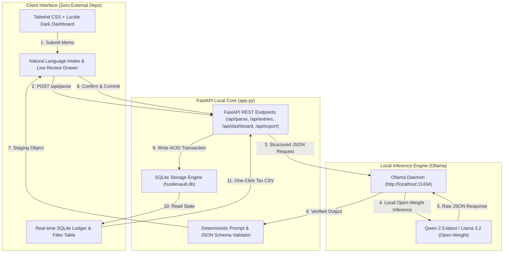

# HustleVault AI: The Zero-Cloud, Local-First Financial Copilot That Kills SaaS Accounting Fees

**Tags:** `#devchallenge` `#hf26challenge` `#hacktoberfest` `#opensource`  
**Challenge Track:** *Hacktoberfest Open-Source AI Challenge: Side Hustle*  
**Theme:** *Build something with open-weight models or open-source AI that someone would actually pay for.*

---

## 💡 The Hook: The $90/Month QuickBooks Tax on Solo Founders

If you run a side hustle, freelance business, or indie SaaS, you know the dreaded accounting dilemma:

1. **The Subscription Extortion:** Tools like QuickBooks, FreshBooks, or Expensify charge between **$35 to $90 every single month**. For a lean side project making its first $1,000, paying $500–$1,000+ a year just to know your net profit and tax deductions is painful.
2. **The Cloud Privacy Nightmare:** Traditional tools demand your bank credentials through aggregators (Plaid/Yodlee) and store your client contracts, vendor invoices, and income records in multi-tenant clouds. If you try using cloud AI assistants, you are beaming confidential client names, rate cards, and financial balances directly to closed-source API providers.

> **Why should recording "Paid $45 to Vercel for Pro hosting" require a recurring cloud subscription and a privacy sacrifice?**

It shouldn't.

Enter **HustleVault AI**: a production-grade, local-first financial intelligence copilot and ledger built with **FastAPI**, **SQLite**, and **open-weight LLMs (Qwen 2.5 / Llama 3.2 running locally via Ollama)**.

---

## 🎯 What HustleVault AI Does

HustleVault AI turns chaotic transaction notes, receipt emails, and invoice memos into structured, audit-ready financial ledgers with **zero cloud dependencies**:

- **Natural Language Parsing:** Drop in messy memos like:
  > *"Paid $45 to Vercel for Pro hosting of client app"*  
  > *"Received $3,200 via Stripe from Acme Corp for Q3 redesign"*  
  > *"Bought Logitech MX Master 3S on Amazon for $99.99 for home office"*
- **Deterministic Extraction:** Using local open-weight models with strict JSON schema enforcement, it instantly extracts:
  - **Transaction Type** (`income` vs. `expense`)
  - **Entity / Counterparty** (Cleaned vendor or client name)
  - **Amount & Currency** (Normalized numerical value and ISO currency code)
  - **Accounting Category** (Software & SaaS, Cloud Hosting, Hardware, Freelance Income, etc.)
  - **Tax-Deductibility Assessment** (`true` / `false` based on IRS Schedule C / freelance ordinary & necessary guidelines)
  - **CPA Rationale** (Plain-English audit justification)
- **Review & Commit Staging:** An inline verification drawer lets you review, tweak, and approve entries before they hit your database.
- **Real-Time Financial Dashboard:** Live KPI cards tracking Gross Income, Operating Expenses, Net Freelance Profit, and Identified Tax Write-Offs (with estimated 25% tax bracket savings).
- **One-Click Tax Season CSV Export:** Instant download formatted for CPA handover or Schedule C filing.

---

## 💰 Why People Would Actually Pay For This

The Hacktoberfest Challenge asks: *“Build something with open-weight models that someone would actually pay for.”*

Here is the commercial viability model for HustleVault AI:

### 1. The "Anti-SaaS" Value Proposition (Immediate ROI)
A freelancer paying $45/month for QuickBooks spends **$540/year**. HustleVault AI provides the core features they actually use (income/expense tracking, categorization, tax write-off discovery, CSV export) with **zero recurring cost**.

### 2. Commercial Monetization Strategy
- **$49 One-Time Lifetime License (Pre-packaged Tauri/Electron Desktop Binary):** Non-technical creators don't want to run terminal commands. Packaging HustleVault AI with a bundled Ollama runtime into a one-click macOS/Windows app has proven commercial success (e.g., Obsidian, Raycast, LM Studio).
- **$29 Pro Country Tax Packs:** Add-on modules for regional tax compliance (US IRS Schedule C categories, UK HMRC Making Tax Digital export, Germany DATEV format, Canada CRA T2125).
- **Client Confidentiality Guarantee for Agency Owners:** High-earning boutique consultants working under strict Non-Disclosure Agreements (NDAs) cannot risk cloud AI leakages. A verifiable local-only AI ledger is a must-have compliance feature.

---

## 🏗️ System Architecture

HustleVault AI is engineered to be lightweight, deterministic, and self-contained.



### Architectural Highlights:
1. **Zero External API Keys:** No OpenAI, no Anthropic, no credit card required. Works 100% offline.
2. **Schema Enforcement:** Ollama's `format: "json"` ensures the model produces strict JSON objects conforming to our Pydantic schema without markdown fluff or hallucinations.
3. **Graceful Degradation:** If Ollama is booting or offline, a built-in heuristic parsing fallback keeps the UI usable without crashing.
4. **SQLite Zero-Config Storage:** Pure single-file persistence (`hustlevault.db`) with zero database server setup.

---

## 🛠️ Code Breakdown

### 1. Deterministic JSON Extraction (`app.py`)
```python
EXTRACTION_SYSTEM_PROMPT = """You are HustleVault AI, a deterministic, privacy-first CPA & ledger intelligence copilot for freelancers.
Extract financial transaction data from the user memo and output ONLY a strictly valid JSON object:
{
  "type": "income" or "expense",
  "party": "Name of Vendor or Client",
  "amount": 0.00,
  "currency": "USD",
  "category": "Software & SaaS | Cloud Hosting | Hardware | Freelance Income | etc.",
  "tax_deductible": true or false,
  "rationale": "Clear 1-sentence CPA rationale for classification"
}"""

@app.post("/api/parse", response_model=ParsedTransaction)
async def parse_memo(req: ParseRequest):
    payload = {
        "model": OLLAMA_MODEL,
        "prompt": f"Transaction memo to analyze: \"{req.memo}\"\nExtract structured JSON:",
        "system": EXTRACTION_SYSTEM_PROMPT,
        "stream": False,
        "format": "json",
        "options": {"temperature": 0.1, "top_p": 0.9}
    }
    # Executes via local HTTPX client to http://localhost:11434/api/generate
```

### 2. Live Ledger & Aggregations
FastAPI computes real-time business health metrics directly against SQLite:
- `total_income`
- `total_expenses`
- `net_profit`
- `tax_deductible_total`
- `estimated_tax_savings` (calculated against standard freelance tax brackets)

---

## 🚀 Quickstart Guide (Run in 2 Minutes)

### Prerequisites
- Python 3.9+
- [Ollama](https://ollama.ai) installed

### Step 1: Clone and Install
```bash
git clone https://github.com/your-username/hustlevault-ai.git
cd hustlevault-ai
pip install -r requirements.txt
```

### Step 2: Pull the Open-Weight Model
```bash
# Pull Qwen 2.5 (recommended for stellar financial reasoning) or Llama 3.2
ollama pull qwen2.5:latest
```

### Step 3: Launch HustleVault AI
```bash
python app.py
```

Open your browser to **`http://localhost:8000`**. You will see the cyber/fintech dashboard ready to intake transactions!

---

## 🔒 The Open-Source Promise & Hacktoberfest Spirit

HustleVault AI proves that open-weight AI is ready to replace bloated SaaS applications. You don't need a multi-million-dollar cloud backend to build high-utility, commercially viable software. With Qwen 2.5 and FastAPI, you can deliver a faster, cheaper, and infinitely more private experience right on the user's laptop.

- **GitHub Repository:** [https://github.com/your-username/hustlevault-ai](https://github.com/your-username/hustlevault-ai)
- **License:** MIT License (100% Free & Open-Source)

Happy Hacktoberfest! Let's build the sovereign, local-first future together. 🚀
